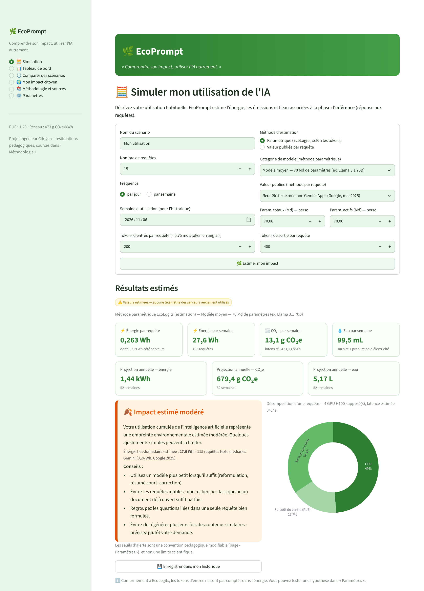
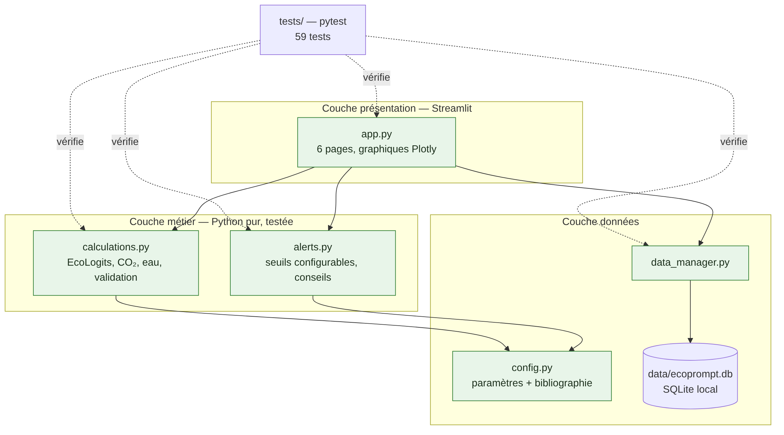
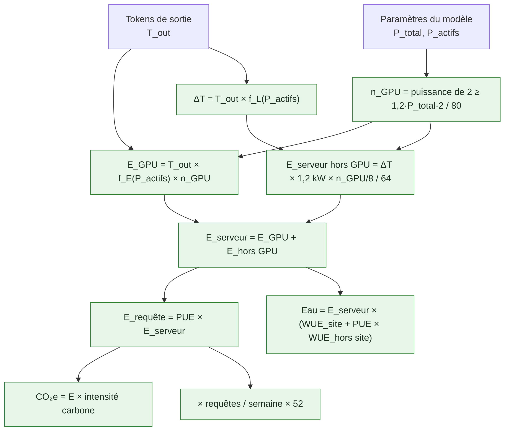

# 🌿 EcoPrompt

> **« Comprendre son impact, utiliser l'IA autrement. »**

*Analyse et sensibilisation à l'empreinte environnementale de l'intelligence artificielle — Projet Ingénieur Citoyen.*

EcoPrompt est une application Python locale (Streamlit) qui **estime, visualise et signale** l'énergie, les émissions de CO₂e et la consommation d'eau associées à l'utilisation d'outils d'IA générative. Elle ne nécessite **aucune API payante** et ne transmet aucune donnée.

> ⚠️ **Toutes les valeurs affichées sont des estimations.** EcoPrompt ne dispose d'aucune télémétrie des serveurs réellement utilisés par les fournisseurs d'IA. Chaque paramètre est rattaché à une source publiée et peut être modifié.



---

## Sommaire

1. [Présentation](#1-présentation-du-projet) · 2. [Problématique](#2-problématique) · 3. [Objectifs](#3-objectifs) · 4. [Fonctionnalités](#4-fonctionnalités) · 5. [Technologies](#5-technologies-utilisées) · 6. [Architecture](#6-architecture-du-projet) · 7. [Installation](#7-installation) · 8. [Exécution](#8-commandes-dexécution) · 9. [Exemples](#9-exemples-dutilisation) · 10. [Méthodologie](#10-méthodologie-de-calcul) · 11. [Sources](#11-sources-scientifiques) · 12. [Limites](#12-limites-du-système) · 13. [Perspectives](#13-perspectives-damélioration) · 14. [GitHub](#14-publier-le-projet-sur-github)

---

## 1. Présentation du projet

L'IA générative est devenue un outil quotidien, mais son coût physique — électricité, refroidissement, eau, matériel — reste invisible pour l'utilisateur. Selon l'Agence internationale de l'énergie, les centres de données ont consommé **415 TWh en 2024 (≈ 1,5 % de l'électricité mondiale)**, avec une projection de **945 TWh en 2030** (IEA, *Energy and AI*, avril 2025).

EcoPrompt rend cet impact **visible, chiffré et sourcé** à l'échelle d'un utilisateur, afin d'encourager un usage plus sobre.

## 2. Problématique

> **Comment sensibiliser les utilisateurs à l'impact environnemental de leurs interactions avec l'intelligence artificielle ?**

## 3. Objectifs

- Estimer l'énergie (Wh), le CO₂e (g) et l'eau (L) liés à un usage déclaré de l'IA, avec des formules transparentes.
- Distinguer clairement valeurs **mesurées**, valeurs **estimées** et **conventions** pédagogiques.
- Alerter (vert / orange / rouge) avec des seuils configurables et des conseils concrets.
- Comparer des scénarios d'usage et montrer l'effet d'habitudes plus sobres.
- Fournir un outil simple, reproductible et défendable devant un jury.

## 4. Fonctionnalités

| Page | Contenu |
|---|---|
| 🧮 **Simulation** | Nombre de requêtes, fréquence (jour/semaine), catégorie de modèle, tokens d'entrée et de sortie, méthode de calcul. Résultats par requête, semaine et année + décomposition GPU / serveur / PUE. |
| 📊 **Tableau de bord** | Indicateurs cumulés, évolution dans le temps, répartition des alertes, énergie par modèle, historique SQLite, export CSV. |
| ⚖️ **Comparer des scénarios** | Scénarios sobre / courant / intensif / images, courbes énergie–tokens par modèle. |
| 🌍 **Mon impact citoyen** | Simulation de changements d'habitudes, effet d'échelle (classe, promo), bons réflexes. |
| 📚 **Méthodologie et sources** | Formules, tableau des paramètres avec leur nature et leur source, entraînement présenté séparément, bibliographie. |
| ⚙️ **Paramètres** | PUE, intensité carbone, profil hydrique, seuils d'alerte, hypothèse sur les tokens d'entrée. |

Système d'alertes (seuils par défaut, **convention pédagogique modifiable**) :

| Niveau | Énergie hebdomadaire estimée | Équivalent en requêtes médianes Gemini (0,24 Wh) |
|---|---|---|
| 🟢 Vert | < 5 Wh | < ≈ 21 |
| 🟠 Orange | 5 à 50 Wh | ≈ 21 à 208 |
| 🔴 Rouge | ≥ 50 Wh | ≥ ≈ 208 |

## 5. Technologies utilisées

Python 3.10+ · Streamlit (interface) · Pandas (données) · Plotly (graphiques interactifs) · SQLite (historique local, bibliothèque standard) · Pytest (tests).

## 6. Architecture du projet

```
EcoPrompt/
├── app.py              # Interface Streamlit (6 pages) — aucune formule ici
├── calculations.py     # Formules EcoLogits, CO₂, eau, validation des entrées
├── alerts.py           # Niveaux d'alerte configurables et conseils
├── data_manager.py     # Historique SQLite (ajout, lecture, export CSV)
├── config.py           # Paramètres + bibliographie (chaque valeur → une source)
├── requirements.txt
├── README.md
├── LICENSE             # MIT
├── .gitignore
├── .streamlit/config.toml   # Thème vert et blanc
├── data/               # Base locale ecoprompt.db (non versionnée)
├── tests/              # 59 tests pytest (formules, alertes, base, interface)
├── docs/               # Rapport PDF, guide de démonstration (MD + PDF), scripts de génération, schémas Mermaid
└── assets/             # Captures d'écran et schémas PNG
```



## 7. Installation

```bash
git clone https://github.com/<votre-identifiant>/EcoPrompt.git
cd EcoPrompt
python -m venv .venv
# Windows : .venv\Scripts\activate      macOS / Linux : source .venv/bin/activate
pip install -r requirements.txt
```

## 8. Commandes d'exécution

```bash
streamlit run app.py          # lance l'application sur http://localhost:8501
python -m pytest -v           # exécute les 59 tests
python docs/build_rapport.py  # régénère le rapport PDF (ReportLab)
```

Documents fournis : `docs/EcoPrompt_Rapport_Ingenieur_Citoyen.pdf` (rapport académique) et `docs/EcoPrompt_Guide_Demonstration.pdf` (guide de soutenance).

## 9. Exemples d'utilisation

Paramètres par défaut : PUE 1,20 ; intensité carbone mondiale 473 g CO₂e/kWh ; eau 0,55 + 1,2 × 3,142 L/kWh. Résultats **estimés** par EcoPrompt :

| Scénario | Énergie / requête | Énergie / semaine | CO₂e / an | Eau / an | Alerte |
|---|---|---|---|---|---|
| Sobre — 5 req./jour, 8 Md, 250 tokens | 0,022 Wh | 0,78 Wh | 0,019 kg | 0,15 L | 🟢 |
| Courant — 15 req./jour, 70 Md, 400 tokens | 0,263 Wh | 27,6 Wh | 0,68 kg | 5,2 L | 🟠 |
| Intensif — 40 req./jour, 405 Md, 1 000 tokens | 9,14 Wh | 2,56 kWh | 63 kg | 479 L | 🔴 |
| Images — 10 images/jour (Luccioni et al.) | 3,49 Wh | 244 Wh | 6,0 kg | 46 L | 🔴 |

Le tableau de bord propose aussi un **historique de démonstration fictif** (8 semaines), clairement étiqueté comme tel.

## 10. Méthodologie de calcul



**Énergie d'inférence (méthode EcoLogits, Rincé & Banse, 2025)** — P en milliards de paramètres, B = 64 :

- `f_E(P) = 1,17·10⁻⁶ · e^(−1,12·10⁻²·B) · P_actifs + 4,05·10⁻⁵` Wh par token de sortie et par GPU
- `n_GPU = 2^⌈log₂(1,2 × P_total × 16/8 / 80)⌉` (GPU H100 de 80 Go)
- `ΔT = T_out × (6,78·10⁻⁴·P_actifs + 3,12·10⁻⁴·B + 1,94·10⁻²)` secondes
- `E_serveur = T_out·f_E·n_GPU + ΔT × 1,2 kW × (n_GPU/8) / B`
- `E_requête = PUE × E_serveur`

**Méthode alternative** : valeur publiée par requête (Google 2025 : 0,24 Wh mesurés ; Luccioni et al. 2024 : 0,047 Wh texte, 2,907 Wh image).

**CO₂e** : `E (kWh) × intensité carbone (g CO₂e/kWh)`.
**Eau** (Li et al., 2025) : `E_serveur (kWh) × [WUE_sur site + PUE × WUE_hors site]`.

**Entraînement** : présenté à part (GPT-3 : 1 287 MWh, 552 t CO₂e estimés ; BLOOM : 433 MWh, 24,7 t CO₂e), non additionné par défaut, car le nombre total de requêtes servies n'est pas publié.

## 11. Sources scientifiques

| Réf. | Source | Nature | Valeurs utilisées |
|---|---|---|---|
| EcoLogits | Rincé & Banse, *JOSS* 10(111) 7471, 2025 — [doc](https://ecologits.ai/latest/methodology/llm_inference/) | Méthode d'estimation | Coefficients f_E, f_L, serveur, PUE fournisseurs |
| Google 2025 | Elsworth et al., [arXiv:2508.15734](https://arxiv.org/abs/2508.15734) | Mesure fournisseur | 0,24 Wh, 0,03 g, 0,26 mL / requête médiane ; PUE 1,09 ; WUE 1,15 L/kWh |
| Luccioni 2024 | Luccioni, Jernite, Strubell, FAccT 2024, [arXiv:2311.16863](https://arxiv.org/abs/2311.16863) | Mesure (CodeCarbon, A100) | 0,047 kWh / 1 000 textes ; 2,907 kWh / 1 000 images |
| Li 2025 | Li, Yang, Islam, Ren, *CACM*, [arXiv:2304.03271](https://arxiv.org/abs/2304.03271) | Estimation | WUE 0,55 L/kWh ; EWIF 3,142 L/kWh |
| Patterson 2021 | [arXiv:2104.10350](https://arxiv.org/abs/2104.10350) | Estimation | GPT-3 : 1 287 MWh, 552 t CO₂e |
| Luccioni 2023 | BLOOM, *JMLR*, [arXiv:2211.02001](https://arxiv.org/abs/2211.02001) | Mesure + estimation | 433 MWh ; 24,7 t / 50,5 t CO₂e |
| Mistral 2025 | [ACV Mistral Large 2](https://mistral.ai/news/our-contribution-to-a-global-environmental-standard-for-ai) (Carbone 4, ADEME) | ACV | 1,14 g CO₂e et 45 mL / réponse de 400 tokens |
| IEA 2025 | *Energy and AI* | Rapport public | 415 TWh (2024), 945 TWh (2030) |
| Ember 2025 | [Global Electricity Review](https://ember-energy.org/latest-insights/global-electricity-review-2025/) | Statistique | 473 g CO₂/kWh (monde, 2024) |
| RTE 2024 | [Bilan électrique 2024](https://analysesetdonnees.rte-france.com/bilan-electrique-2024/emissions) | Statistique officielle | 21,7 (direct) / 30,2 (ACV) g CO₂e/kWh |
| OWID 2026 | [Carbon intensity of electricity](https://ourworldindata.org/grapher/carbon-intensity-electricity) | Statistique | UE 211,2 ; Chili 259,9 g CO₂e/kWh (2024) |
| Meta / Mistral | Documentation Llama 3.1 et Mixtral 8x22B | Doc. technique | Nombres de paramètres |

## 12. Limites du système

- **Pas de télémétrie** : les fournisseurs commerciaux ne publient ni la taille de leurs modèles ni leur consommation par requête (sauf Google, valeur médiane non auditée).
- **Modèle simplifié** : EcoLogits suppose des GPU H100, un lot de 64 et ignore réseau, stockage et inactivité ; la latence est estimée par une formule de repli.
- **Tokens d'entrée** non comptés par la méthode de référence (hypothèse optionnelle dans les paramètres).
- **Localisation inconnue** des serveurs : l'intensité carbone et l'eau peuvent varier d'un facteur 10 et plus.
- **Hors périmètre** : terminal de l'utilisateur, fabrication du matériel, entraînement (affiché à part), effets rebond.
- **Seuils d'alerte** : convention pédagogique, non scientifique.
- **Écart entre études** : pour l'eau, 0,26 mL (Google, sur site) à 45 mL (Mistral, ACV complète) par requête — les périmètres diffèrent.

## 13. Perspectives d'amélioration

Mesure locale réelle (CodeCarbon sur un petit modèle exécuté sur le PC) · extension navigateur comptant les requêtes · prise en compte de l'heure et du lieu (intensité carbone horaire) · embodied carbon · mise à jour automatique des facteurs · version anglaise/espagnole · intégration des futures normes (AFNOR Frugal AI, ISO).

## 14. Publier le projet sur GitHub

> Le dépôt n'a **pas** été publié automatiquement : suivez ces étapes depuis votre ordinateur.

1. Créez un compte sur <https://github.com> si nécessaire, puis installez Git : <https://git-scm.com/downloads>.
2. Sur GitHub : **New repository** → nom `EcoPrompt` → *Public* → **ne cochez pas** « Add a README » (il existe déjà) → **Create repository**.
3. Dans un terminal, depuis le dossier `EcoPrompt` :

```bash
git init                                  # inutile si le dossier contient déjà .git
git add .
git commit -m "EcoPrompt : version initiale"
git branch -M main
git remote add origin https://github.com/<votre-identifiant>/EcoPrompt.git
git push -u origin main
```

4. Lors du `push`, GitHub demande une authentification : utilisez un **Personal Access Token** (Settings → Developer settings → Tokens) ou GitHub Desktop.
5. Optionnel : ajoutez le sujet `ingenieur-citoyen`, `green-it`, `streamlit` dans *About*.

Alternative avec GitHub CLI : `gh auth login` puis `gh repo create EcoPrompt --public --source=. --push`.

---

Licence MIT — © 2026 Felipe Dipp Alcon. Projet pédagogique : les estimations ne remplacent pas une analyse de cycle de vie.
